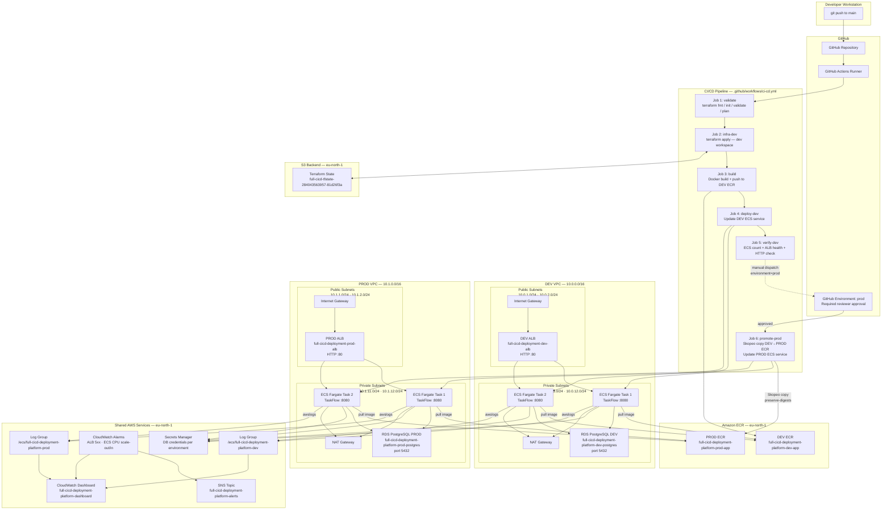

# Architecture Diagram

**Project:** Full CI/CD Deployment Platform — SG/PRJ/DO-02
**Runtime confirmed:** Amazon ECS Fargate (both DEV and PROD)
**Diagram type:** Mermaid (render in GitHub, VS Code with Mermaid extension, or https://mermaid.live)

---

## Full System Architecture



---

## Source-to-Deployment Path

```
git push to main
    │
    ▼
GitHub Actions: validate (terraform fmt/init/validate/plan)
    │
    ▼
GitHub Actions: infra-dev (terraform apply — DEV workspace)
    │
    ▼
GitHub Actions: build
  • docker build application/ (multi-stage: Maven → JRE Alpine)
  • docker push :latest + :<git-sha> → DEV ECR
    │
    ▼
GitHub Actions: deploy-dev
  • aws ecs describe-task-definition (get current)
  • jq: swap container image to new SHA tag
  • aws ecs register-task-definition (new revision)
  • aws ecs update-service (rolling deployment)
  • Poll until rolloutState = COMPLETED
    │
    ▼
GitHub Actions: verify-dev
  • ECS running count >= 2
  • ALB target group healthy >= 2
  • GET /health → HTTP 200
```

---

## Application Request Path

```
User browser / API client
    │  HTTP :80
    ▼
Internet Gateway (public subnet)
    │
    ▼
Application Load Balancer
  • Listener: HTTP :80
  • Target group: full-cicd-deployment-dev-ecs-tg (ip type, port 8080)
  • Health check: GET /health → 200, interval 30s
    │  HTTP :8080 (round-robin)
    ▼
ECS Fargate Task (private subnet, no public IP)
  • Spring Boot TaskFlow application
  • DB credentials injected from Secrets Manager at task start
    │  TCP :5432
    ▼
RDS PostgreSQL (private subnet)
  • Database: appdb
  • Schema: tasks table (JPA-managed via spring.jpa.hibernate.ddl-auto=update)
```

---

## Network Security Boundaries

```
┌─────────────────────────────────────────────────────────────┐
│  PUBLIC (internet-facing)                                   │
│  • ALB security group: inbound HTTP :80 from 0.0.0.0/0     │
│  • ALB security group: outbound all                         │
│  • Internet Gateway attached                                │
│  • Subnets: map_public_ip_on_launch = true                  │
└─────────────────────────────────────────────────────────────┘
                          │ HTTP :8080
┌─────────────────────────────────────────────────────────────┐
│  PRIVATE (application tier)                                 │
│  • ECS task SG: inbound :8080 from ALB SG only              │
│  • ECS task SG: outbound all (for ECR pull via NAT)         │
│  • No public IP on ECS tasks                                │
│  • Subnets: map_public_ip_on_launch = false                 │
│  • Route: 0.0.0.0/0 → NAT Gateway                          │
└─────────────────────────────────────────────────────────────┘
                          │ TCP :5432
┌─────────────────────────────────────────────────────────────┐
│  PRIVATE (database tier)                                    │
│  • RDS SG: inbound :5432 from ECS task SG only              │
│  • RDS SG: inbound :5432 from DEV ECS SG (sg-06fa229574228b45c) │
│  • RDS SG: inbound :5432 from 106.213.81.205/32 (temp rule) │
│  • publicly_accessible = false                              │
│  • Storage encrypted at rest                                │
└─────────────────────────────────────────────────────────────┘
```

---

## Implementation vs Target Architecture Gap

| Component | Target | Actual | Notes |
|---|---|---|---|
| Application runtime | ECS Fargate | ECS Fargate ✅ | Confirmed live |
| Load balancer | ALB | ALB ✅ | Both DEV and PROD active |
| Database | RDS PostgreSQL | RDS PostgreSQL ✅ | Both environments available |
| Secrets | Secrets Manager | Secrets Manager ✅ | Injected into ECS tasks |
| Monitoring | CloudWatch | CloudWatch ✅ | Dashboard, alarms, log groups |
| Notifications | SNS | SNS ✅ | Topic exists; email subscription needs confirmation |
| CI/CD | GitHub Actions | GitHub Actions ✅ | 6-job pipeline |
| State backend | S3 | S3 ✅ | Encrypted, S3 native locking |
| EC2 ASG module | Not in target | Exists in `modules/compute/` ⚠️ | Legacy code, not wired into main.tf |
| OIDC auth | Best practice | IAM user keys ⚠️ | Access keys used; OIDC not configured |
| RDS restore verification | Verified data | Instance available, data unverified ⚠️ | Blocked by account EC2 restriction |
| Zero-downtime proof | Measured | Not yet measured ⚠️ | Requires concurrent request test during deploy |
